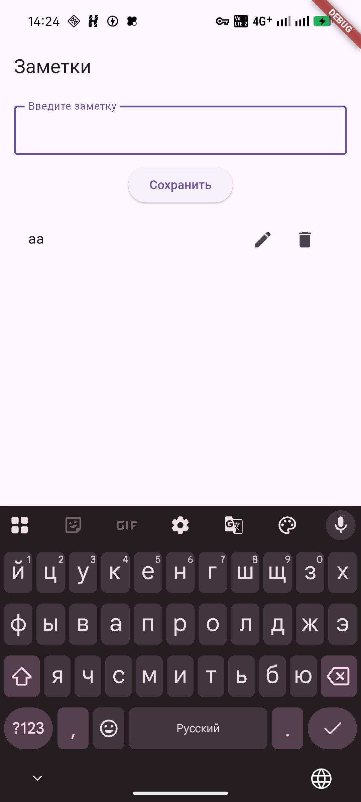
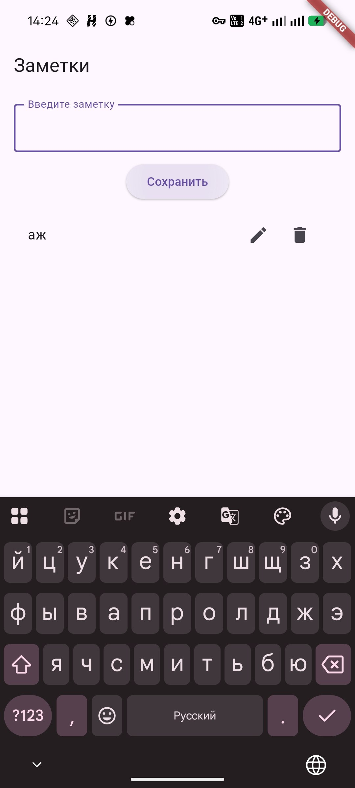
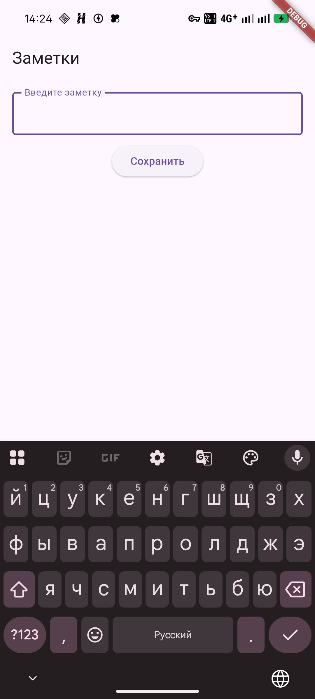

# Заметки

Приложение для заметок на Flutter. Сделано для практической работы.

## Функционал

### 1. Добавление заметки
Вверху экрана есть поле для ввода текста. Пользователь пишет туда заметку и нажимает кнопку "Сохранить". После этого заметка добавляется в список ниже, а поле очищается, чтобы можно было писать следующую. Если поле пустое, то при нажатии на кнопку ничего не происходит, пустые заметки не сохраняются.

### 2. Список заметок
Все сохранённые заметки показываются под кнопкой в виде списка, новые добавляются в конец. Список можно прокручивать, если заметок много. У каждой заметки справа есть две иконки: карандаш и корзина.

### 3. Редактирование заметки
Если нажать на карандаш, текст этой заметки появится в поле ввода. Его можно изменить и снова нажать "Сохранить". Тогда старый текст заменится на новый, а новая заметка не добавится. После сохранения приложение возвращается в обычный режим, и можно снова добавлять новые заметки.

### 4. Удаление заметки
Если нажать на корзину, заметка сразу удаляется из списка. Если в этот момент редактировалась какая-то заметка, то редактирование сбрасывается, а поле очищается. Так не получится случайно сохранить изменения в уже удалённую заметку.

## Как запустить

1. Установить Flutter
2. Открыть проект в Android Studio или VS Code
3. Написать в терминале:

```
flutter pub get
flutter run
```

## Как сделано

Весь код находится в файле `lib/main.dart`.

- `TextField` нужен для ввода текста
- `TextEditingController` позволяет брать текст из поля и очищать его
- `ElevatedButton` это кнопка "Сохранить"
- заметки хранятся в списке `List<String> notes`
- `ListView.builder` показывает заметки на экране
- `IconButton` это кнопки с карандашом и корзиной
- `setState` обновляет экран, когда список поменялся
- переменная `editIndex` хранит номер заметки, которую сейчас редактируем (если `-1`, то ничего не редактируем)

Функции в коде:

- `saveNote()` добавляет новую заметку или сохраняет изменения, если идёт редактирование
- `editNote(index)` кладёт текст выбранной заметки в поле
- `deleteNote(index)` удаляет заметку из списка

### 1. Добавление заметки
Вверху экрана есть поле для ввода текста. Пользователь пишет туда заметку и нажимает кнопку "Сохранить". После этого заметка добавляется в список ниже, а поле очищается, чтобы можно было писать следующую. Если поле пустое, то при нажатии на кнопку ничего не происходит, пустые заметки не сохраняются.

![Добавление заметки]

### 2. Список заметок
Все сохранённые заметки показываются под кнопкой в виде списка, новые добавляются в конец. Список можно прокручивать, если заметок много. У каждой заметки справа есть две иконки: карандаш и корзина.

### 3. Редактирование заметки
Если нажать на карандаш, текст этой заметки появится в поле ввода. Его можно изменить и снова нажать "Сохранить". Тогда старый текст заменится на новый, а новая заметка не добавится. После сохранения приложение возвращается в обычный режим, и можно снова добавлять новые заметки.

![Редактирование заметки]

### 4. Удаление заметки
Если нажать на корзину, заметка сразу удаляется из списка. Если в этот момент редактировалась какая-то заметка, то редактирование сбрасывается, а поле очищается. Так не получится случайно сохранить изменения в уже удалённую заметку.

![Удаление заметки]